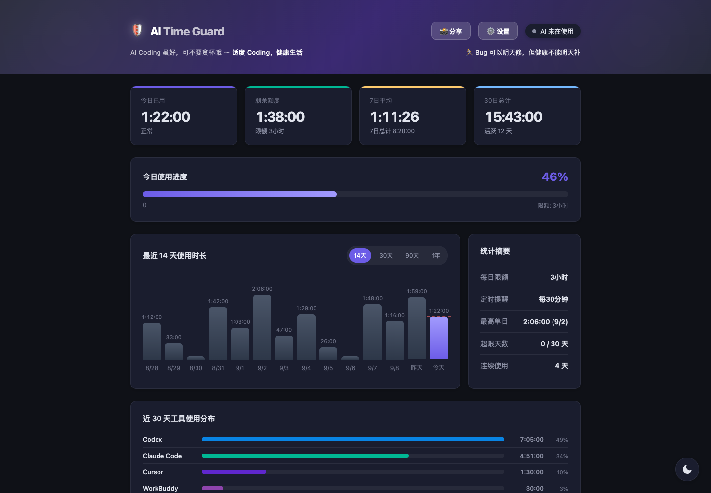
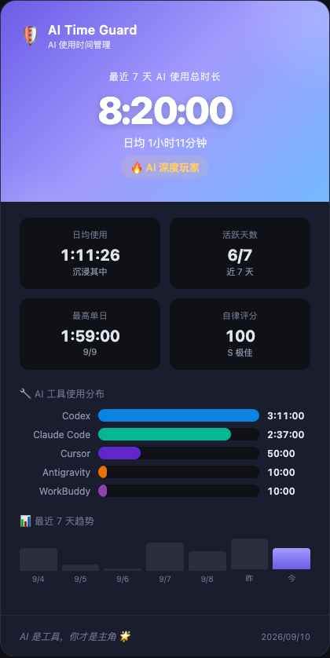

# AI Time Guard

> A local-first macOS menu bar app that measures time spent in AI coding tools,
> adds a daily limit, and turns the result into a clear dashboard.



AI Time Guard helps you notice when an AI-assisted coding session has quietly
become an all-day session. It detects supported desktop apps and terminal tools
only while they are actively in use, keeps all data on your Mac, and provides a
dashboard plus a shareable report card.

## Highlights

- Tracks active time across Codex, Claude Code, Cursor, CodeBuddy, WorkBuddy,
  Antigravity, Kimi, ZCode, MiniMax Code, Windsurf, Trae, Zed, and selected
  AI-assisted note apps.
- Sets a daily time budget with warning, periodic reminder, and strict modes.
- Shows daily, monthly, and yearly trends in a responsive local dashboard.
- Produces a share card without sending usage history to a remote service.
- Stores configuration and history locally in `~/.ai-time-guard/`.



## Requirements

- macOS 12 or later
- Python 3.9 or later
- Accessibility permission for detecting the frontmost app
- Optional: Playwright and Chromium for PNG export

## Install and run

```bash
git clone https://github.com/yafeishi/ai-time-guard.git
cd ai-time-guard
python3 -m venv .venv
source .venv/bin/activate
pip install -r requirements.txt
python ai_time_guard.py
```

Open <http://127.0.0.1:19527> for the dashboard. You can also double-click the
included `AI Time Guard.app` after the virtual environment has been created in
the repository directory.

For image export, install the optional browser dependency:

```bash
pip install playwright
playwright install chromium
```

## How tracking works

AI Time Guard combines the current frontmost macOS application with a lightweight
process check. GUI tools count only while their app is in the foreground. CLI
tools count only while a supported terminal is in the foreground and the tool's
process is running. Checks run every 10 seconds by default.

The app records only duration and tool category. It does **not** capture prompts,
source code, keystrokes, screenshots, or window contents.

## Local API

The server listens on `127.0.0.1:19527` and exposes these endpoints:

| Endpoint | Method | Purpose |
| --- | --- | --- |
| `/api/report` | GET | Full history, configuration, and current status |
| `/api/today` | GET | Lightweight summary for today |
| `/api/daily/YYYY-MM-DD` | GET | One day's usage |
| `/api/summary?days=N` | GET | Daily aggregation, up to 365 days |
| `/api/summary/monthly?months=N` | GET | Monthly aggregation, up to 120 months |
| `/api/summary/yearly?years=N` | GET | Yearly aggregation, up to 20 years |
| `/api/config` | GET, POST | Read or update local settings |
| `/api/generate-image?type=share\|card` | GET | Export a PNG with Playwright |

Example:

```bash
curl -s http://127.0.0.1:19527/api/today | python3 -m json.tool
curl -s "http://127.0.0.1:19527/api/generate-image?type=card" -o card.png
```

The API is intentionally unauthenticated for local integrations. Do not expose
port `19527` to the internet. See [SECURITY.md](SECURITY.md) for details.

## Data and configuration

| File | Description |
| --- | --- |
| `~/.ai-time-guard/config.json` | Limits, reminder behavior, theme, and interval |
| `~/.ai-time-guard/history.json` | Daily totals and per-tool durations |
| `~/.ai-time-guard/debug.log` | Local diagnostic log |

Delete the directory to remove all local AI Time Guard data.

## Development

```bash
python -m unittest discover -s tests -v
```

The interface is implemented with dependency-free HTML, CSS, and JavaScript;
the menu bar service and local API live in `ai_time_guard.py`.

## Limitations

- App and process names are heuristic and may change between tool releases.
- The included `.app` bundle is an unsigned launcher, not a notarized build.
- Sleep, crashes, or force-quitting between history flushes can lose up to one
  minute of the latest session.
- AI Time Guard is a personal awareness tool, not employee-monitoring software.

## License

[MIT](LICENSE)

### 站立提醒与记录

站立弹窗提供「我已经站立」和「知道了」两个按钮。确认已经站立后记录一次实际站立，并从确认时间开始下一轮倒计时；选择「知道了」会保留待站立状态，每 5 分钟再次提醒。关闭弹窗后，可从「站立提醒 → 我已经站立（记录一次）」补记。

报告显示今日提醒次数、实际站立次数和最近 7 天的每日统计。每次提醒和站立确认的时间保存在 `~/.ai-time-guard/stand-up.json`，应用重启后仍然保留。手动「立即提醒一次」也会计入提醒次数。旧版本没有采集这些事件，因此无法补回此前的站立记录。

站立提醒支持暂停 1 小时或 2 小时。统一从「暂停站立提醒」子菜单选择时长，到期自动恢复并弹窗提醒；也可随时立即恢复。暂停截止时间会保存，重启不会延长暂停，已经累计的站立计时继续保留。

菜单提供「下班／上班」按钮。下班停止站立提醒并取消临时暂停的自动恢复，AI 使用统计及其提醒继续；上班从当前时间开始新一轮站立计时，不计作实际站立。上下班状态在重启后保留，跨日不会自动上班。


### 统一事件提醒

菜单「事件提醒 → 添加／管理提醒」打开报告页面，可添加、编辑和删除多个并行事件。支持单次倒计时、完成后重复、固定间隔重复，独立暂停／恢复、稍后提醒，以及暂停 1／2 小时后自动恢复。编辑不重置本轮计时，重新开始后采用新时长。

每个事件可设为仅上班期间或全天。下班只停止工作范围事件的提醒；上班为已启动的工作范围事件开始新一轮，全天事件不受影响。同一时刻到期的确认弹窗事件合并显示，可全部确认，也可稍后在各自菜单中分别确认。普通通知需要在菜单或配置页记录完成。

现有倒计时时长迁移为「握力训练」（初始未开始），站立状态和截止时间迁移为「站立活动」；旧站立记录继续保留。统一事件从迁移时起分别记录到点提醒、追提醒和完成次数。事件及记录保存在 `~/.ai-time-guard/events.json`，重启恢复，不包含多设备同步。默认只创建上述两个事件，用药事件需自行确认间隔并开始。

事件菜单和管理页面支持「全屏专注」。点击全屏开始后启动新一轮，大号显示计时，支持暂停／继续和退出；Esc 退出展示不会取消计时。专注期间暂缓应用弹窗，页面失联后约 15 秒恢复提醒。单次倒计时到点记录本轮完成，重复事件需要实际完成后确认。此功能不锁定系统，也不屏蔽其他应用的通知。

菜单顶层直接显示各事件的状态和主要动作，无需先进入事件子菜单。点击未开始的单次事件打开全屏专注；点击暂停事件恢复；点击「我已完成」记录实际完成。限时暂停、取消和重新开始在各事件的「更多操作」中，配置在「管理事件与记录」页面；AI 统计与设置集中到独立子菜单。

macOS 的全屏专注入口现使用独立原生窗口覆盖鼠标所在屏幕，隐藏菜单栏和 Dock，不再依赖浏览器。Esc、退出按钮或切换到其他应用可结束专注展示，事件计时继续。浏览器全屏页面保留作为兼容入口。

精简版菜单只显示单次专注入口、重复事件状态、上下班、设置和退出。常规重复事件运行时是只读状态；待完成时可回应，未开始时可启动。辅助操作统一移到设置页面。原生单次专注画面只显示大号剩余时间和退出按钮，到点显示「完成」，不再展示暂停、再来一轮等按钮。重新进入运行中的专注会延续原来的计时。

站立活动的主按钮现在为「站立 1 分钟」。点击后启动原生一分钟倒计时，到点才记录站立并开始下一轮 45 分钟提醒；提前退出取消本次站立倒计时，不产生完成记录。设置中的手动补记入口仍保留。

可启用工作日自动时段（`event_schedule_enabled`）：北京时间周一至周五 08:00 开启，次日 01:00 暂停全部事件，包括全天事件；周五延续到周六 01:00，周末其余时间暂停。剩余时间保留，重启、休眠唤醒后自动核对当前时段；手动上下班可临时覆盖，直到下一个计划边界。未启动的单次专注不会自动开始。AI 使用统计独立运行。


### 摄像头辅助（macOS）

检测原理、计数规则、频率口径及隐私说明见 [眨眼检测说明](docs/BLINK_DETECTION.md)，设置页「摄像头辅助」也可展开「眨眼是怎么检测的？」查看简版说明。

设置页「摄像头辅助」可分别启用眨眼检测、离座自动暂停。首次使用会在本机编译独立的 AVFoundation／Vision 组件，需要 Apple Command Line Tools；运行组件位于 `~/.ai-time-guard/runtime/AI Time Guard Camera.app`。macOS 首次请求权限时，请允许 **AI Time Guard Camera** 访问摄像头。Python 主进程不读取、保存或上传画面，只接收人数、眼睛开合程度等数值信号。摄像头组件通过 macOS 沙箱明确禁止所有网络连接（包括本机网络连接），只通过进程管道传递数值；网络隔离不可用时拒绝启动检测。关闭两个开关或下班后释放摄像头。

菜单栏「眨眼检测」可直接查看近期频率、目标是否达到、今日眨眼次数及有效检测时长、近 7 天次数、在座状态；支持切换眨眼检测／离座暂停、选择目标频率及离座确认时间、重新校准。详细设置入口会直接展开页面中的摄像头辅助。

- 自然睁眼面对摄像头约 5 秒完成校准。有效画面累计约一分钟后，显示近期眨眼频率；目标默认 12 次／分钟，可调整为 5～40。低于目标时使用与事件提醒一致的弹窗，点击「知道了」关闭，关闭后至少间隔 5 分钟再提醒。在座且有效检测时才触发；全屏专注期间不弹该提示。
- 光线、眼镜、角度与帧率会影响结果。多人入镜或眼睛无法可靠检测时不判断眨眼频率；不足约 10 fps 时暂停眨眼判定。这里不能测定眨眼是否完全闭合，也不提供医学判断。
- 默认连续 10 秒未检测到人脸或上半身后暂停活动（可调 3～120 秒），连续约 2 秒重新检测到人后继续。保持原来的剩余时间，不覆盖手动暂停；站立一分钟不受离座暂停影响。摄像头失联、权限拒绝或关闭功能时解除摄像头造成的自动暂停，避免卡住计时。该功能不识别身份，其他人进入镜头也可能恢复活动。
- 每日只保存眨眼次数及有效观察秒数到 `~/.ai-time-guard/camera-history.json`，不保存照片、视频或人脸模板。工作日自动暂停和上下班规则优先于回座恢复。

离座自动暂停开启时，默认同步显示屏幕级「离座休息中」画面及离座时长，覆盖当前所有显示器。回座、关闭离座检测、进入休息时段或摄像头失联时自动退出。Esc 可只退出画面，同一次离座不再弹出，活动仍保持离座暂停；已有专注或站立一分钟全屏时不覆盖。菜单栏或设置页「离座全屏画面」可关闭此展示。全屏画面不锁定电脑，也不自动记录站立完成。

眨眼频率明细：设置页「摄像头辅助 → 眨眼频率明细」可按北京时间日期、分页查看每分钟的次数、有效检测时长、频率、当时目标及结果。目标变更按目标分行；有效观察不足 50 秒保留次数但不判定达标。明细保存在本机 `~/.ai-time-guard/blink-history.sqlite3`，分钟切换、定期保存、查询和正常关闭时写入。重启后保留，不记录图像或眼部坐标。旧版日汇总继续保留，但无法还原旧分钟明细。

眨眼即时测试：摄像头辅助区域显示本次校准后识别次数、最近识别时间、睁闭眼状态、实际采样帧率及开合比例；这些诊断信号只保留在本机内存，不写入明细。先自然睁眼约 5 秒完成左右眼各自校准，再眨眼观察即时计数。检测采用左右眼各自基准、闭合／重新睁开的双阈值，支持短闭合和闭合期间短暂眼部特征丢失；单眼眨动、整张人脸丢失及长时间闭眼不计为一次眨眼。

10 秒眨眼对照：摄像头辅助中点击「开始 10 秒对照」，先准备 3 秒，再按页面倒计时完成 10 秒测试。采样窗口由本机统一计时，不以聊天消息到达时间为准；只计算窗口内开始并结束的完整闭合。先填写自己数到的次数，再揭晓机器计数及差值。检测覆盖不足会标注结果无效。测试结果和最近 30 秒的数值诊断只留在内存，关闭应用即清除；不录制或传输画面。


### 离座安全锁屏

「设置 → 摄像头辅助 → 离座后的屏幕行为」提供「系统安全锁屏」「全屏休息展示」「仅暂停活动」，菜单栏同样可切换。需开启离座自动暂停；安全模式优先于全屏展示，确认离座后调用真正的 macOS 锁屏，程序不提供解锁接口。有脸进入画面、按 Esc、关闭摄像头或修改选项均不能代替系统认证。

安全模式在发出锁屏请求后保持活动暂停，确认系统锁定、本账号随后认证解锁且重新检测到在座后才恢复。锁屏期间关闭摄像头；解锁后自动重新校准。系统会话状态不可读取、锁屏失败或未得到锁定确认时，显示错误并保持活动暂停，需手动系统锁屏并解锁完成确认。安全锁屏优先于专注／站立全屏；系统锁屏期间显示 macOS 原生界面，自定义计时不覆盖锁屏。上次锁定时长会在解锁后的设置页显示，本次进程重启后该时长清空。

实际锁屏由 Mac 的登录认证保护，支持方式由 macOS 配置决定（例如密码、Touch ID、已启用的 Apple Watch 解锁）；程序不接触登录密码、指纹或人脸身份模板。系统锁屏调用使用运行时检测的 `login.framework` 接口，它是系统私有接口，未来系统升级可能不再提供；不可用时明确报错，不用普通全屏窗口冒充锁屏。默认保持原有展示模式；选择安全锁屏后记住选择。
